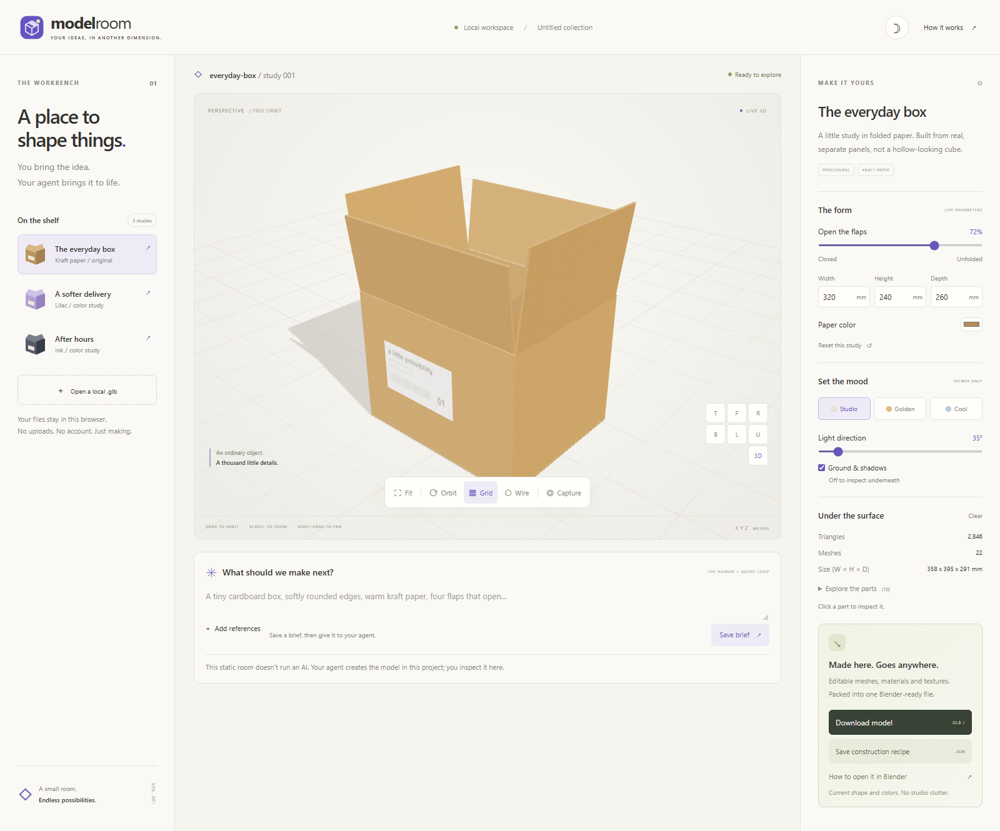

<p align="center"></p>
<h1 align="center">Model Room</h1>
<p align="center">A little space for big ideas.<br />A local-first workbench for human ideas and agent-authored 3D models.</p>

**Describe it with your agent. Inspect it in your room. Take it into Blender.**



*The original procedural box in the actual workbench: articulated panels, studio
lighting, live dimensions and model-only GLB export. No imported finished asset.*

Model Room is a static Three.js website, not a hosted AI service. Your coding
agent builds original procedural models in this repository from your prompt and
references. You inspect them here and download real, editable meshes as a
self-contained **GLB**.

## Open the room

```powershell
cd C:\devdesk\homedesk\ModelRoom
npm ci
npm run dev
```

Open **http://127.0.0.1:4173/**. Node.js 22.12+ is required; the supported
Vite 8 Node ranges also include 24+ (Node 26 is used in this workspace).
The server binds to loopback, not your network. Stop that terminal with Ctrl+C.

## On the workbench

| Look closer | Make it yours | Take it with you |
|---|---|---|
| Full orbit, zoom and pan | Four hinged box flaps | Blender-compatible `.glb` |
| Seven camera presets, including underneath | Actual dimensions and paper color | Reproducible box recipe `.json` |
| Wireframe, grid, selectable parts | Three lighting setups and movable light direction | Viewport `.png` |
| Light/dark interface | Kraft, lilac and ink color studies | Prompt/reference brief `.json` |
| Local self-contained GLB import | Keyboard and touch navigation | No account, upload or runtime CDN |

All three starter studies are variations of **one original cardboard-box model**,
not three independently generated objects. The page cannot generate arbitrary
models from text. [The agent workflow](docs/AGENT-WORKFLOW.md) explains how new
objects get built and added.

**Controls:** drag to orbit; right-drag to pan; wheel/pinch to zoom. Touch:
one finger orbits, two fingers pan/pinch. Focus the viewer for arrow-key orbit,
`+`/`-` zoom and `F` fit. Bottom view hides the ground and grid so the underside
isn't occluded. Automatic rotation starts off.

**Blender:** click **Download model**, then **File > Import > glTF 2.0 (.glb/.gltf)**.
[Import guide and format limits](docs/BLENDER.md).

## Keep making

[User guide](docs/USER-GUIDE.md) ·
[Agent modeling workflow](docs/AGENT-WORKFLOW.md) ·
[Architecture](docs/ARCHITECTURE.md) ·
[Research and source receipts](docs/RESEARCH.md) ·
[Development journal](TODO/02_DEVELOPMENT_LEDGER.todo) ·
[Workstreams](TODO/00_INDEX.todo) ·
[Verification](docs/VERIFICATION.md) ·
[Contributing](AGENTS.md)

```powershell
npm run check
npm test
npm run build
npm run test:browser
```

`npm run build` creates the deployable static site in `dist`. This task does not
publish it. Prompts/references are not uploaded or automatically persisted:
download your brief and retain your original image files.
