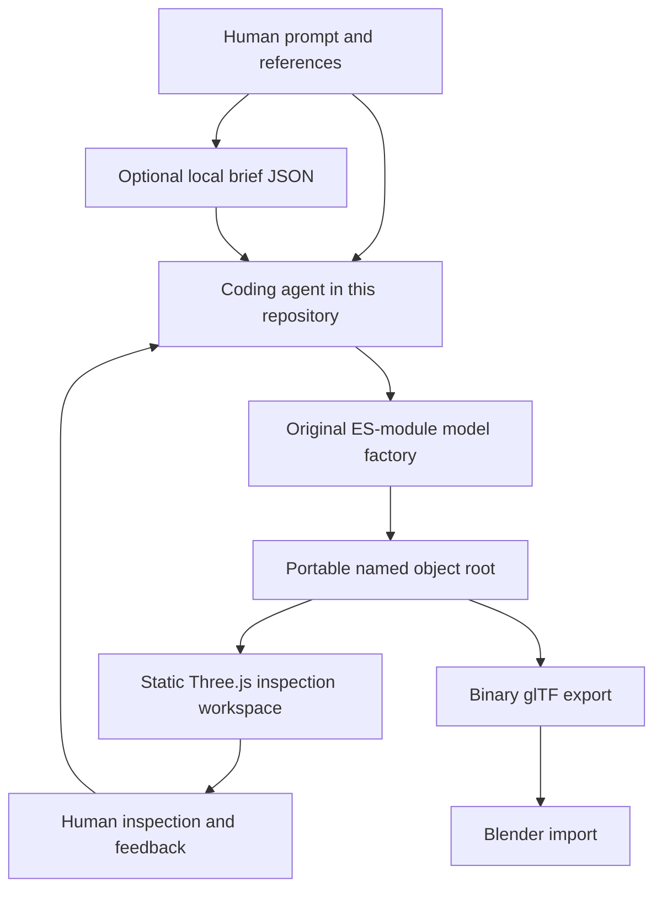

# Architecture: a model, a viewer, a conversation

The arrows describe file/feedback flow, not automatic AI execution. There is
no application backend. Vite is development/build tooling; production consists
only of static files. `base: './'` makes the output work under a hosted subpath.
No sibling source, context, repository credentials or reference image is an
application build input.

## Ownership

| Module | Responsibility |
|---|---|
| `src/models/box.js` | Validated construction recipe, real panels/creases, articulation |
| `src/textures.js` | Deterministic paper grain and original printed label |
| `src/viewer.js` | Camera, orbit, lights, floor/grid, selection, render scheduling |
| `src/model-io.js` | Model bounds/statistics, binary import/export, downloads/disposal |
| `src/main.js` | DOM/recipe integration, shelf studies, brief/reference UX |
| `src/styles.css` | Responsive workspace, light/dark theme, reduced-motion policy |
| `public/logo.svg` | Original open-room/cube mark and lime possibility spark |

## Geometry and units

The closed outer body is width X, height Y, depth Z in meters, front +Z.
Default 320/240/260 mm. Board thickness is 4 mm; rounded panel edges use a
0.65 mm visual radius. RoundedBoxGeometry keeps local symmetry. Bottom and
four side walls are separate solids. Side dimensions avoid duplicate corner
volume. Four movable flap groups are located at their crease lines.

For openness `u` in [0,1], hinge angle is `sign * (-pi/2 + 2.35*u)` on the
appropriate X or Z axis. Side hinges are lower than the long hinges so closed
flaps layer rather than sharing a plane. This is a stylized kinematic model,
not finite-thickness folding/contact or structural cardboard simulation.
Small cut-edge strips communicate layered paper; they aren't a resolved
corrugated manufacturing cross-section.

The input recipe is whitelisted into a new object; unknown properties do not
become model code. Invalid numeric, openness, color and study inputs throw.

## Color and light

Color textures are explicitly sRGB; Three's working lighting space is linear.
Standard PBR materials use nonmetallic matte paper. The renderer outputs sRGB,
uses ACES filmic tone mapping and a moderate studio exposure; environment
illumination is generated locally using RoomEnvironment and PMREM.
Directional key/fill/rim lighting plus hemisphere fill keep the object legible.
Light direction rotates their group around the measured object center.

Viewer-only tone mapping/lighting isn't baked into the GLB. The theme changes
the interface/background, not the model's paper color.

## Inspection and scheduling

The camera orbits instead of rotating the authored root. Perspective fit uses
the complete model's bounding-sphere radius and the smaller horizontal/vertical
half-FOV. Articulated bounds are recomputed when flaps move; the floor and
light/shadow envelopes follow. Browser resize updates aspect and refits on
large aspect changes. Plane/grid aren't part of the measured object.

Frames are requested on changes; damping keeps requesting until settled and
automatic orbit is explicitly opt-in. Hidden tabs stop scheduling. Pixel
ratio is capped at2, shadow map1024. This is a resource budget, not a guarantee
of a particular frame rate on every machine.

Picking uses pointer coordinates relative to the actual WebGL canvas and the
nearest ray intersection. The hit walks toward a declared inspectable owner;
selection draws a separate bounding helper, never changing exported material.
Arrow keys operate only when the viewer region is focused, not while typing.

## Import/export boundary

GLB input must have a valid v2 header/length/JSON chunk, <=50 MB, embedded
buffers/images and no required extensions. The loader decodes that binary
locally. No external URI is permitted. The previous root is replaced only
after a valid mesh/bounds result; out-of-order imports dispose stale results.

Export serializes a cloned object root with binary output and TRS transforms.
Canvas images become embedded image payloads. Stage geometry never enters
that root. The current static pose is exported, not JavaScript animation code.
No Draco/KTX/Meshopt decoder, imported animation playback, sculpting, scene
hierarchy editor or parametric Blender modifier conversion is included.

Each root replacement disposes unique geometries, materials and texture
resources, including imported image bitmaps. Final disposal also stops frame
requests, aborts event handlers, disconnects resize observation and releases
environment/render resources. Context loss surfaces a visible reload notice.

## Privacy and persistence

Reference previews are object URLs, not uploads; removing/unloading releases
them. The brief JSON contains image metadata only. Prompt/reference state,
theme and edits are session-only. Downloads are the explicit persistence path.
Model download errors and invalid inputs report visible messages.

The preview renderer parses local files; it is not a malicious-file sandbox.
The 50 MB cap is not a decoded GPU-memory guarantee. Only open trusted models.
